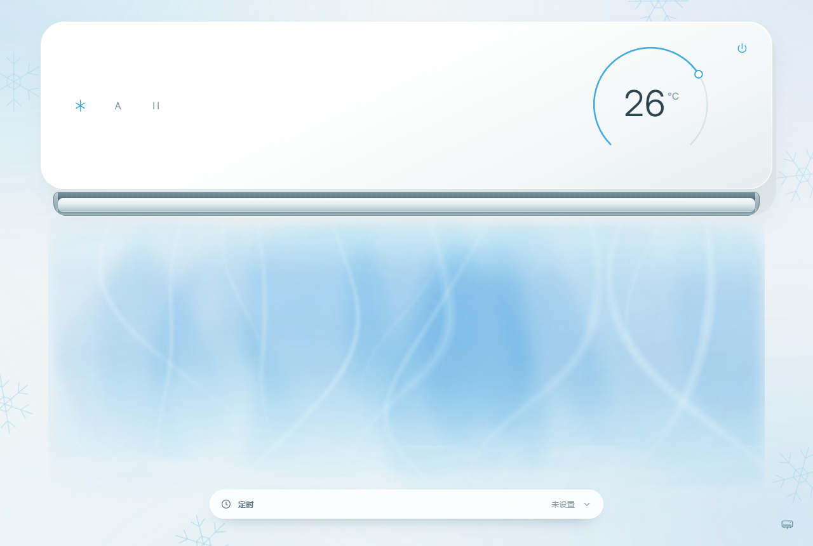
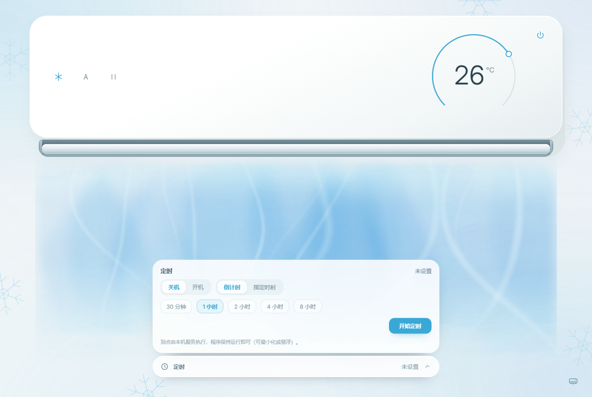

# AIRA · 空调

[](https://github.com/Pikasn/aira-airconditioner/actions/workflows/tests.yml)
[](https://github.com/Pikasn/aira-airconditioner/releases)
[](LICENSE)
[](https://github.com/Pikasn/aira-airconditioner/releases)

> **玩电脑的时候，空调遥控器又找不到了？**
>
> 打游戏、写代码、追剧正到一半，不想起身找遥控器，也不想解锁手机、打开米家 App、等页面加载——
> AIRA 把空调控制放到 Windows 桌面上：双击即开，圆环调温，模式、风速、扫风、定时都在手边，不经过云端。
>
> **Tired of hunting for the remote or reaching for your phone just to change the temperature?**
> AIRA puts your air conditioner on the Windows desktop: dial control, modes, fan speed, swing and timers — all local, no cloud.

支持 **米家空调伴侣 2**（`lumi.acpartner.mcn02`）· Windows 10/11



---

## 为什么用它

- **打游戏 / 写代码 / 追剧时不想切出去**：温控悬浮条或悬浮球可以置顶常驻，调温、开关不用离开当前窗口。
- **手机在充电、不在手边**：不用解锁手机找米家 App，电脑上直接完成开关、调温和模式切换。
- **睡前或出门前想设个定时**：底部「定时」条支持倒计时或指定时刻，到点自动关机/开机。
- **只想瞄一眼现在多少度**：主界面、悬浮条、浮球都会显示设定温度与模式。
- **在意隐私**：局域网直连空调伴侣，不经过米家云，也没有账号和遥测。

例如：开黑正到关键局，忽然觉得热——低头看一眼常驻的悬浮球，滚轮滚两下就调好温度，不用切回桌面，也不用找手机。

## 目录

- [为什么用它](#为什么用它)
- [功能一览](#功能一览)
- [界面与操作](#界面与操作)
- [设备连接](#设备连接)
- [安装与运行](#安装与运行)
- [从源码运行](#从源码运行)
- [构建 Windows 安装包](#构建-windows-安装包)
- [测试](#测试)
- [项目结构](#项目结构)
- [技术架构](#技术架构)
- [隐私与安全](#隐私与安全)
- [已知限制](#已知限制)
- [更新日志](#更新日志)
- [贡献](#贡献)
- [许可证](#许可证)
- [English summary](#english-summary)

---

## 功能一览

| 功能 | 说明 |
| --- | --- |
| **温度控制** | 16–30°C，步进 1°C。主圆环支持中心左减右加、外圈点选/拖动、滚轮、方向键；数字、圆弧、刻度同步反馈。 |
| **五种模式** | 制冷、制热、除湿、送风、自动。每种模式有独立的配色、边缘纹样和气流语言。 |
| **四档风速** | 自动、低、中、高；自动档表示设备自动档，不表示实际电机转速。 |
| **上下扫风** | 开/停两种状态，导风板与气流方向实时联动。 |
| **定时（1.6.2）** | 倒计时或指定时刻，到点关机或开机；折叠条常驻显示倒计时；由本机后台服务执行，主窗口最小化或悬浮时同样生效。 |
| **三种窗口形态** | 标准主界面、温控悬浮条、温控悬浮球，可在设置中独立选择。 |
| **原生桌面体验** | 无边框窗口、DWM Acrylic 毛玻璃、一体化标题栏、窗口按钮、拖动、最大化/还原、尺寸与位置记忆、单实例唤醒、系统托盘。 |
| **设备状态同步** | 3 秒轮询设备状态；断线自动降级；设备忙时控制请求自动重试，不丢失刚拖动的温度。 |
| **气流可视化** | 连续体积雾 + 渐细流线 + 不规则阵风；支持 GPU 加速，显卡不可用时自动降级为纹理雾；遵循系统“减少动态效果”。 |
| **本机安全** | 接口只监听 `127.0.0.1`，同源校验、请求头校验、请求体大小限制、CSP；Token 使用 Windows DPAPI 按当前用户加密保存。 |
| **连接配置页** | 填写伴侣的局域网 IP 与 Token，支持局域网设备发现；连接信息只保存在本机。 |

### 温度控制

- 主圆环默认显示当前设定温度，圆心左侧点击减 1°C、右侧点击加 1°C。
- 圆环外圈可直接点选目标温度，也可以按住拖动。
- 支持鼠标滚轮、方向键（`↑`/`→` 加，`↓`/`←` 减）、`PageUp`/`PageDown`（±2°C）、`Home`/`End`（上下限）。
- 数字、圆弧、刻度同步更新；连续调温会合并后串行下发，避免频繁请求设备。
- 真机温度范围为 16–30°C；当前模式没有设定温度时（如送风/除湿且设备无目标温度），圆环显示 `—` 并禁用调温。

### 模式、风速与扫风

- 左侧三枚按钮依次切换模式、风速、上下扫风，点击后立即生效并写入设备。
- 每次操作都会先读取设备真实状态，再下发控制，并在写后重读确认；设备未确认时只同步状态，不会重复发送指令。
- 模式与风速会改变气流颜色、密度、速度与形态；扫风会改变导风板位置并带动气流方向。
- 除湿/送风等模式下设备没有目标温度时，界面自动隐藏不可用的温度数据。

### 定时（1.6.2 新增）

主界面底部新增「定时」折叠条：

- 点击展开面板，选择 **关机 / 开机**。
- 支持两种方式：
  - **倒计时**：30 分钟、1 小时、2 小时、4 小时、8 小时。
  - **指定时刻**：选择任意 `HH:MM`；如果距离当前时间不足 30 秒，则按次日该时刻计算。
- 点击「开始定时」后，折叠条与面板都会显示 `剩余时间 后 关机/开机`。
- 定时保存在本机 `.local/timer.json`，程序重启后仍然有效；如果重启时已经过点，会立即补执行一次。
- 定时由**本机服务执行**：主窗口最小化、隐藏到托盘、或者使用温控悬浮条/浮球时，到点仍会执行。
- 执行时如果设备忙或暂时离线，会自动重试两次；仍失败会明确显示「定时执行失败，请检查设备后手动处理」，不会误报成功。
- 单次定时最短 30 秒、最长 24 小时；可在面板中随时「取消定时」。
- 定时只在程序运行时执行；完全退出程序后不会触发。



### 三种窗口形态

在设置页的「窗口模式」中独立选择：

1. **标准主界面**：完整机身、温度圆环、控制按钮与气流。
2. **温控悬浮条**：紧凑横条，显示温度与控制图标；拖动空白处移动，靠近屏幕边缘后收起为温度签，鼠标移入展开；末尾窗口图标回到主界面。
3. **温控悬浮球**：圆形浮球，滚轮调温；颜色表示模式，一圈细线的转速表示风速；点击回到主界面。

两种悬浮模式都支持右键菜单（模式、设置、退出），悬浮置顶可以在设置中开关。横条与浮球不会自动互相展开或收起。

### 托盘与窗口

- 右下角空调图标进入设置；系统托盘图标左键返回主界面，右键切换窗口模式或退出。
- 窗口大小可自由调整，机身、圆环、按钮和气流随可用空间缩放；窄窗保持横向机身并保留可操作尺寸。
- 窗口大小/位置记忆；首次升级 1.6.x 时会把过高的旧窗口迁移为紧凑横窗。
- 重复启动快捷方式不会打开第二个实例，而是唤醒已有窗口。

### 气流的含义

气流用于表达当前设备状态（模式、风速、扫风方向），并以视觉方式示意：

- 制冷为连续冷雾带与柔和流线，不叠加雨丝或闪烁颗粒。
- 制热为暖色卷曲热流，除湿为稀疏水汽，送风为轻盈流线，自动为双色柔雾。
- 风速越高，气流越长、越快、扰动越明显。
- 遵循系统「减少动态效果」设置；显卡不可用时自动使用纹理雾。
- 气流是状态示意，**不能证明空调机身真的执行了红外指令**。

---

## 界面与操作

1. 双击桌面「空调」快捷方式或程序目录中的 `空调.exe`。
2. 第一次使用会进入设置页：填写空调伴侣的局域网 IP 和 Token，点击连接。
3. 连接成功后回到主界面：
   - 右侧圆环调温，右上角电源键开关机。
   - 左侧三枚按钮切换模式 / 风速 / 扫风。
   - 底部「定时」条设置定时。
   - 右下角齿轮进入设置；系统托盘图标可回到主界面或切换窗口形态。
4. 关闭窗口后程序与本机服务退出，空调保持当前设置。

---

## 设备连接

适配 **米家空调伴侣 2**，型号 `lumi.acpartner.mcn02`。

需要准备：

- 空调伴侣已接入米家，且完成空调遥控匹配。
- 电脑与伴侣在**同一局域网**。
- 伴侣的局域网 IP 与 32 位 Token（可用 [Xiaomi Cloud Tokens Extractor](https://github.com/PiotrMachowski/Xiaomi-cloud-tokens-extractor) 获取）。

连接信息保存在程序目录下的 `.local/device.json`，Token 使用 Windows 当前用户的 DPAPI 加密；换 Windows 用户或换电脑后需要重新连接。程序不向任何服务器上传连接信息。

---

## 安装与运行

1. 从 [Releases](https://github.com/Pikasn/aira-airconditioner/releases) 下载最新的 `AIRA-<version>-Windows.zip`。
2. 解压到任意目录（建议不要放在系统目录），保持 `空调.exe` 与 `_internal` 文件夹在同一目录。
3. 双击 `空调.exe`。

系统要求：

- Windows 10/11（64 位）。
- Microsoft Edge WebView2 Runtime（Windows 11 通常已内置；Windows 10 如缺失请安装）。
- 桌面毛玻璃需要 Windows 11 22H2（22621）以上；不支持时会显示浅色背景，其他功能不受影响。

---

## 从源码运行

需要 Windows、Python 3.11+ 与 WebView2 Runtime。

```powershell
python -m pip install -r requirements-desktop.txt
python desktop.py
```

源码目录下还保留了旧版浏览器启动器（`Start-AIRA.cmd` / `Stop-AIRA.cmd` / `launch.py`），仅用于开发调试。

---

## 构建 Windows 安装包

```powershell
python -m pip install -r requirements-build.txt
python build.py
```

产物位于 `dist/空调`。

- `build.py` 会优先使用 Node 运行 `frontend/build.cjs` 重新生成 `index.html`；没有 Node 时自动使用 `frontend/build.py`（与 `build.cjs` 输出逐字节一致）。
- `index.html` 是 `frontend/` 的构建产物，请修改 `frontend/refactor-*` 源文件后重新构建，不要直接编辑 `index.html`。
- 打包配置见 `空调.spec`，使用 PyInstaller onedir 模式，资源目录为 `_internal`。

---

## 测试

```powershell
python -m pip install -r requirements-dev.txt
python -m pytest tests -q
```

当前共有 112 项自动化测试，覆盖：

- 设备协议映射（开关、模式、风速、温度、扫风）与异常状态解析；
- 控制串行化、设备忙拒绝、型号校验、丢包后不重发；
- 本机接口安全（同源、请求头、请求体大小、限速、CSP、私有文件不可访问）；
- DPAPI 凭据存储与配置迁移；
- 桌面封装（打包根目录、单实例、窗口尺寸）；
- 悬浮控件与悬浮面生命周期；
- 定时任务的接口、校验、持久化、到点执行、失败重试与失败状态。

测试使用内存存储与模拟驱动，不连接真实设备、不发送红外指令；测试中的 IP、Token 均为示例值，不对应任何真实设备。

---

## 项目结构

```text
.
├─ backend/                 # 本机服务：协议、状态、接口、定时
│  ├─ app.py                # FastAPI 应用与 /api/* 路由
│  ├─ device.py             # 米家空调伴侣 2 协议适配
│  ├─ discovery.py          # 局域网设备发现
│  ├─ models.py             # 能力与输入约定
│  ├─ service.py            # 串行控制、轮询、定时任务
│  └─ settings.py           # DPAPI 加密配置存储
├─ frontend/                # 可编辑的界面源码与构建脚本
│  ├─ refactor-*.js/.css/.html
│  ├─ build.cjs             # Node 构建入口
│  └─ build.py              # 等价的 Python 构建入口（无 Node 时使用）
├─ tests/                   # 自动化测试
├─ docs/                    # 截图与历史记录
│  ├─ screenshots/
│  └─ history/
├─ desktop.py               # 桌面入口：窗口、单实例、本机服务生命周期
├─ window_chrome.py         # 原生毛玻璃与标题栏
├─ presentations.py         # 主界面 / 悬浮条 / 浮球
├─ floating_*.py            # 悬浮窗口绘制与交互
├─ desktop.css / desktop.js # 桌面模式样式与桥接
├─ floating.css / floating.js
├─ setup.html / setup.js / setup.css
├─ index.html               # 前端构建产物
├─ 空调.spec                # PyInstaller 打包配置
├─ build.py                 # 构建与打包入口
└─ requirements*.txt / constraints*.txt
```

---

## 技术架构

```text
空调.exe (desktop.py 冻结版)
 ├─ 单实例互斥量 + session 唤醒已有窗口
 ├─ 本机 HTTP 服务 127.0.0.1:8765–8795 (FastAPI + uvicorn)
 │   └─ DeviceService：轮询 / 串行控制 / 定时任务
 │       └─ miio UDP 54321 → 米家空调伴侣 2
 ├─ pywebview (WebView2) → index.html / setup.html
 │   └─ WindowChrome js_api：窗口按钮、拖动、模式切换、置顶
 └─ 悬浮条 / 悬浮球：独立分层窗口，GDI+ 绘制
```

- 前端与接口同源，页面通过 `fetch` 调用本机 `/api/*`。
- 所有写操作先读设备、再下发、写后重读确认；丢包/超时只补读，不重发控制。
- 定时任务保存在 `.local/timer.json`，由轮询线程检查并调用同一套控制流程执行。

---

## 隐私与安全

- **不联网**：所有操作都在本机局域网完成，没有云服务、账号体系或遥测上报。
- **凭据只在本机**：Token 使用 Windows DPAPI（当前用户）加密，保存在 `.local/device.json`；换用户或换机后无法解密，需要重新连接。
- **本机接口保护**：只监听 `127.0.0.1`；校验同源、`X-Aira-Request` 请求头、JSON 类型与 8KB 请求体上限；响应带 CSP、`nosniff`、`frame-ancestors 'none'` 等头；不开放静态目录。
- **日志与状态本地化**：`.local` 下的日志、窗口/外观状态、定时设置都只保存在本机，不纳入发布包。
- 使用 `Release` 中的安装包时，`SHA256SUMS.txt` 可用于核对文件完整性。

---

## 已知限制

- 本版本只适配米家空调伴侣 2（`lumi.acpartner.mcn02`），不接入蓝牙温湿度计。
- 伴侣本身不提供室温/湿度读数，界面会在无数据时隐藏这些信息；功率读数可用时会显示。
- 控制通过伴侣红外转发，界面状态来自伴侣记录；**无法确认空调机身实际执行结果**。
- 定时需要程序保持运行；完全退出程序后不会触发。
- 自动风速表示设备自动档，不代表实际电机转速。
- 桌面毛玻璃依赖 Windows 11 22H2 与系统透明效果设置；其他系统使用浅色背景。

---

## 更新日志

当前版本 **1.6.2**。完整记录见 [CHANGELOG.md](CHANGELOG.md)。

---

## 贡献

欢迎提交 Issue 与 Pull Request。开发、测试与提交约定见 [CONTRIBUTING.md](CONTRIBUTING.md)。

---

## 许可证

本项目使用 **GNU General Public License v3.0**，见 [LICENSE](LICENSE)。

Copyright (C) 2026 Pikasn

第三方组件与字体许可见 [THIRD_PARTY_NOTICES.md](THIRD_PARTY_NOTICES.md)；Windows 安装包内附完整第三方许可证目录。

---

## English summary

AIRA is a Windows desktop remote for the Xiaomi Mijia Air Conditioner Companion 2 (`lumi.acpartner.mcn02`). It runs a local-only FastAPI service and a WebView2 UI, and talks to the device over the local network (miio/UDP) without any cloud dependency.

Tired of hunting for the remote while gaming or coding, or unlocking your phone to open the Mi Home app just to change the temperature? AIRA keeps the controls on your desktop, with a floating bar/ball that can stay on top of your work.

Highlights: temperature dial (16–30°C), five modes, four fan speeds, vertical swing, one-shot timers (countdown or clock time, execute even when the window is hidden), three window presentations (main window, floating bar, floating ball), native acrylic window chrome, tray integration, reconnection handling, and a layered airflow visualization that degrades gracefully without GPU support.

Build with Python 3.11+, run `python -m pytest tests -q`, package with `python build.py` (PyInstaller, output in `dist/空调`). Licensed under GPL-3.0.
